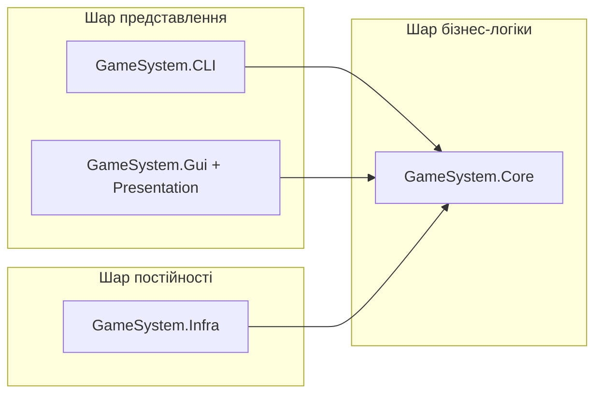
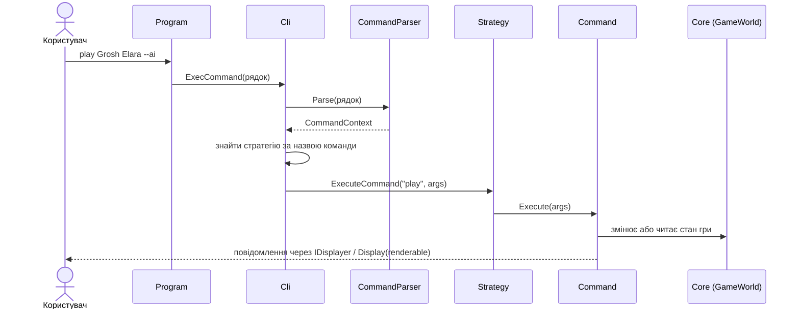
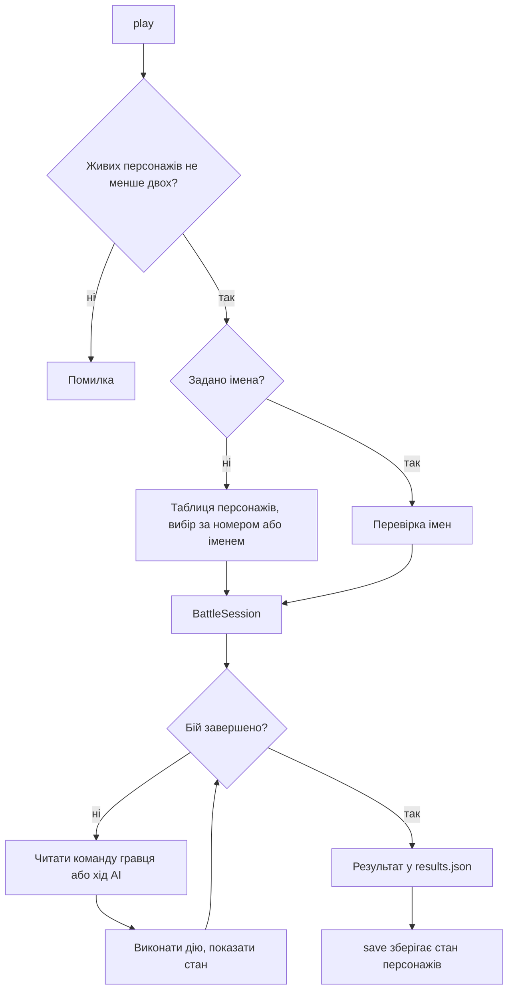
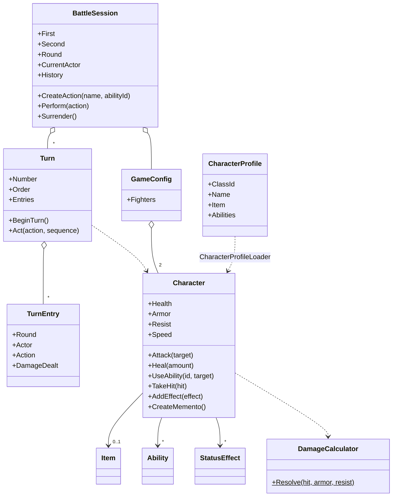
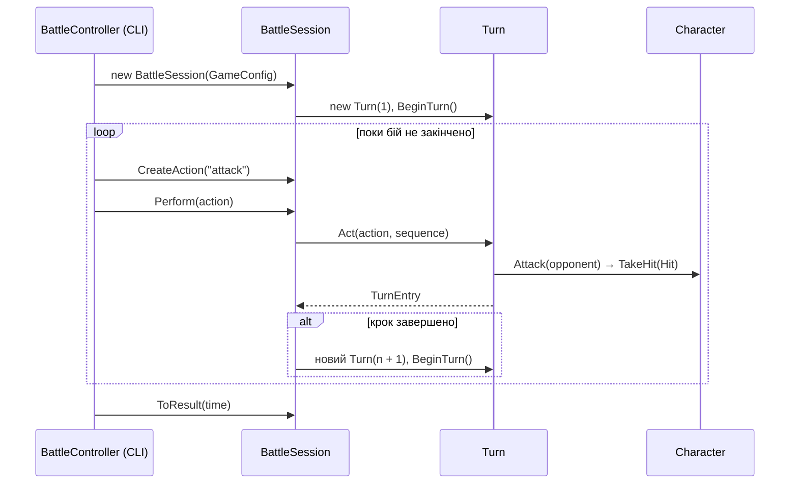
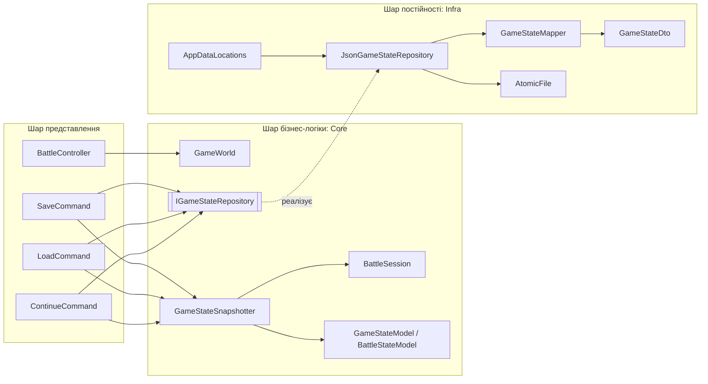
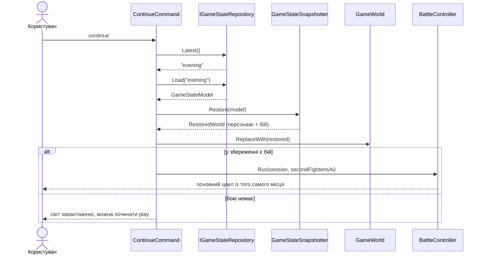
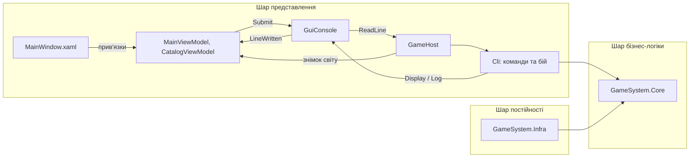

# Дизайн-документ: GameSystem

У цьому документі описано, як влаштований проєкт GameSystem (проста текстова гра). Розділи 1–8 — командний
інтерфейс (практична 13), розділ 9 — бізнес-логіка гри (практична 14), розділ 10 — постійність інформації (практична 15), розділ 11 — графічний інтерфейс (практична 16).

## 1. Про проєкт

GameSystem — це текстова гра з персонажами. Користувач створює персонажів (Warrior або Mage), предмети і вміння,
одягає предмети, навчає вмінням, бере персонажів із віддаленої бази (Genshin API), б'ється двома персонажами
один проти одного, зберігає стан гри і результати боїв.

Весь функціонал доступний через консольний інтерфейс (CLI) і через графічне вікно (GUI, розділ 11). Є ще окремий проєкт `GameSystem.FileManager`
(практична 12, файловий менеджер), який використовує ту саму бібліотеку розбору команд, але до цієї практичної він не належить.

## 2. Загальна архітектура

Проєкт поділений на шари, як на схемі із завдання.



| Проєкт | Що там знаходиться |
|---|---|
| `GameSystem.Core` | правила гри, персонажі, бій, текстова система (документи), інтерфейси (`IDisplayer`, `IRenderer`, репозиторії). Нічого не знає про консоль і файли |
| `GameSystem.Infra` | усе, що працює із зовнішнім світом: консоль, JSON-файли, HTTP-клієнт до Genshin API, текстовий рендер документів |
| `GameSystem.CLI` | консольний інтерфейс: фасад `Cli`, стратегії команд, команди, рендерери, консольна графіка, `Program.cs` |
| `GameSystem.Presentation` | логіка графічного вікна без WPF: консоль вікна, `GameHost`, view-моделі (розділ 11) |
| `GameSystem.Gui` | графічне вікно на WPF: XAML, конвертер зображень, точка збирання програми |
| `GameSystem.FileManager` | окрема програма (практична 12) |
| `GameSystem.Tests` | xUnit-тести для всіх проєктів |

Головне правило: **залежності йдуть до Core**. Core оголошує інтерфейси (наприклад, `IGameStateRepository`,
`IRenderer<T>`), а Infra і CLI їх реалізують. Тому Core можна тестувати без консолі та диска,
а консоль можна замінити на графічний інтерфейс, не чіпаючи правил гри.

## 3. Командний інтерфейс (детально)

### 3.1. Що він вміє

- вибирати й виконувати команди з аргументами та опціями (`add --char_id Grosh --id Sword`);
- розширюватися новими командами без зміни старого коду;
- виводити об'єкти гри в однаковому, структурованому вигляді (таблиці, смужки здоров'я, документи);
- вести гру: вибір персонажів, початок бою, основний цикл, збереження результатів.

### 3.2. Діаграма класів


### 3.3. Відповідність схемі із завдання

Я взяв **другий варіант схеми** (з `IRenderable`), тому що тоді внутрішні класи самі вирішують, ЯКІ дані показати,
а ЯК це виглядає в консолі вирішує CLI. Залежність іде від CLI до Core, а не навпаки.

| На схемі | У проєкті | Примітка |
|---|---|---|
| `CLI` | `Cli` | фасад із методами `UseStrategy`, `ExecCommand`, `Display` |
| `ArgParser.parseArgs` | `CommandParser.Parse` (`ICommandParser`) | повертає `CommandContext` |
| `Args` | `CommandContext` | назва команди, позиційні аргументи, опції |
| `ICommandStrategy` | `ICommandStrategy` | `GetCommandSelectors`, `RegisterCommand`, `ExecuteCommand` |
| `SpecificStrategy` | `InformationCommandStrategy`, `TransformativeCommandStrategy`, `InfrastructureCommandStrategy`, `BattleCommandStrategy` | три категорії з методичних вказівок + команди бою |
| `registerCommand(Func<?,?>)` | `RegisterCommand(ICommand)` | замість лямбди команда є окремим класом (патерн Command) |
| `IRenderable<T>` | `IRenderable<T>` | у Core; базова реалізація `Renderable<T>` |
| `SpecificRenderable` | `CharacterSheetRenderable`, `RosterRenderable`, `BattleStatusRenderable`, `GameResultsRenderable` | у Core |
| `IRenderer<T>` | `IRenderer<T>` | оголошений у Core, реалізується в CLI |
| `SpecificRenderer` | `TextDocumentRenderer`, `RosterRenderer`, `BattleStatusRenderer`, `GameResultsRenderer` | у CLI |

Чого немає на схемі, але я додав:

- `Cli.UseRenderer<T>` — реєстр рендерерів. `Cli.Display` по типу даних `T` знаходить потрібний рендерер.
  Якщо рендерер не зареєстровано, використовується той, що об'єкт отримав через `UseRenderer`.
- `IDisplayer` (вже був у проєкті) — «порт виводу» нижчого рівня. Рендерери та команди пишуть через нього
  повідомлення (інфо, успіх, попередження, помилка), а реалізація (`ConsoleDisplayer`) вже малює їх у консолі з кольором.

### 3.4. Що відбувається, коли користувач вводить команду



Якщо команда кидає виняток, `Cli` ловить його і показує `Execution Error: ...`, програма не падає.
Якщо команди не існує, показується попередження.

### 3.5. Категорії команд (стратегії)

Методичні вказівки пропонують три категорії. Кожна категорія це окрема стратегія, і `Cli` параметризується ними.

**Information — виводить інформацію, нічого не змінює**

| Команда | Що робить |
|---|---|
| `ls <char\|item\|ability> [--id x]` | список об'єктів (персонажі у вигляді таблиці зі смужкою здоров'я) або деталі одного |
| `sheet <char>` | аркуш персонажа як структурований текстовий документ |
| `results` | історія завершених ігор (таблиця) |
| `help` | усі команди, згруповані за категоріями |

**Transformative — змінює світ гри**

| Команда | Що робить |
|---|---|
| `create <char\|item\|ability>` | створення через діалог |
| `add --char_id x --id y` | одягнути предмет або навчити вмінню |
| `act <attack\|heal\|defend\|ability> <actor> [target] [--id ability]` | одна дія поза боєм |
| `play [char1 char2] [--ai]` | вибір персонажів, початок гри й основний цикл бою |

**Infrastructure — зберігання та зовнішні сервіси**

| Команда | Що робить |
|---|---|
| `save <name>` / `load <name>` / `list` | збереження стану гри (разом із боєм, що триває), завантаження, список збережень |
| `continue [<name>]` | продовжити з останнього збереження (або з названого), у тому числі повернутися в бій, що не закінчився (розділ 10) |
| `remote chars\|weapons\|create\|equip` | робота з віддаленою базою персонажів |

Команди, які діють лише під час бою, лежать в окремій стратегії `BattleCommandStrategy`:
`attack`, `heal`, `defend`, `ability [id]`, `status`, `surrender`, `help`.

### 3.6. Гра: вибір персонажів, початок, основний цикл, збереження



- **Вибір персонажів**: `play Grosh Elara` або просто `play` (тоді показується таблиця з номерами).
- **Початок гри**: створюється `BattleSession` (Core). Це покрокова версія бою: гравці ходять по черзі,
  лічильник раунду росте після ходу другого бійця. Автоматичний бій (`Game`) залишився для симуляцій.
- **Основний цикл** (`BattleController`): показати стан, прочитати рядок, виконати його через **окремий `Cli`**
  зі стратегією `BattleCommandStrategy`. Недійсна команда не забирає хід. Опція `--ai` (її краще писати в кінці)
  віддає ходи другого бійця комп'ютеру (`ITurnStrategy`).
- **Збереження результатів**: після перемоги `GameResult` (переможець, переможений, раунди, здоров'я, час UTC)
  додається в `results/game-results.json` через `IGameResultRepository`. Команда `results` показує історію.
- **Збереження стану**: `save <name>` зберігає всіх персонажів із їхнім здоров'ям у `saves/<name>.json`.

### 3.7. Власні моделі CLI

- **Command** — кожна команда окремий клас, який успадковує `CommandBase`: `CreateCommand`, `PlayCommand`, `SaveCommand` тощо.
  Залежності (світ гри, `IDisplayer`, репозиторії) отримує через конструктор.
- **Args** — `CommandContext`.
- **CLI-графіка** (`GameSystem.CLI.Graphics`): `ProgressBar` (смужка здоров'я `[#####-----]`) і `ConsoleTable` (вирівняні таблиці).
- **Prompter** — маленький помічник для діалогів (запитати рядок, запитати невід'ємне число).

## 4. Патерни проєктування

| Патерн | Де |
|---|---|
| Facade | `Cli` — єдина точка входу для зовнішнього коду |
| Strategy | `ICommandStrategy` та його реалізації; `IRenderer<T>`; `ITurnStrategy` для AI |
| Command | `ICommand`, `CommandBase` і конкретні команди; бойові дії `ICombatAction` |
| Visitor | текстова система: `ITextVisitor` і `TextRenderer` |
| Template Method | `CommandBase.Execute` викликає `Run` |
| Memento | збереження персонажів (`CharacterMemento`, `GameStateSnapshotter`) |
| Factory | `CharacterFactory`, `CombatActionFactory` |
| Dependency Injection | `CliFactory` збирає всі частини, тести підставляють підроблені |

## 5. Як розширювати

**Нова команда.** Створити клас, що успадковує `CommandBase`, і зареєструвати його в потрібній стратегії
(`RegisterCommand(new MyCommand(...))`). Більше нічого міняти не треба, команда з'явиться в `help`.

**Нова категорія команд.** Створити клас на основі `CommandStrategyBase` і додати його в `CliFactory` рядком `cli.UseStrategy(...)`.
Якщо дві стратегії мають однакову команду, `UseStrategy` кине виняток.

**Новий спосіб показати дані.** Створити клас, що реалізує `IRenderer<T>`, і зареєструвати його через `cli.UseRenderer(...)`.
Для іншого інтерфейсу (GUI) потрібно лише написати інші рендерери для тих самих `IRenderable<T>`.

## 6. Обробка помилок

- Некоректні аргументи: команда показує `Usage: ...` і нічого не змінює.
- Винятки всередині команд: `Cli` показує `Execution Error`.
- Проблеми файлів і мережі (`IOException`, `HttpRequestException`, пошкоджений JSON): команди показують зрозуміле повідомлення.
- Невдала дія в бою (наприклад, невідоме вміння): хід не передається, гравець пробує ще раз.
- Кінець вводу під час бою: бій вважається покинутим, результат не зберігається.

## 7. Тестування

Тести лежать у `GameSystem.Tests`. Консоль і диск підміняються тест-дублерами (`FakeDisplayer`, `FakeInputReader`,
`InMemoryGameStateRepository`, `InMemoryGameResultRepository`), тому тести швидкі та не залежать від середовища.

- `CLI/CliFacadeTests`, `CLI/CommandStrategyTests` — фасад і стратегії;
- `CLI/CliCommandTests` — усі старі команди через фасад;
- `CLI/PlayCommandTests` — вся гра від вибору персонажів до збереження результату;
- `CLI/GraphicsTests` — смужка здоров'я й таблиці;
- `Core/BattleSessionTests`, `Core/RenderableTests`;
- `Infra/JsonGameResultRepositoryTests`.

## 8. Обмеження й плани

- Бій лише для двох персонажів. Команди бою читаються по черзі з одного вводу (гра за одним комп'ютером).
- Графічне вікно описано в розділі 11; воно користується тими самими командами, що й CLI.
- Опція `--ai` у `play` має стояти після імен, бо парсер вважає наступне слово значенням опції.


## 9. Бізнес-логіка (практичне заняття 14)

Бізнес-логіка живе в `GameSystem.Core`, у шарі посередині схеми. Вона нічого не знає про консоль, файли й мережу:
усе зовнішнє заходить через інтерфейси (`IGameStateRepository`, `ICharacterProfileSource`, `IGenshinApiClient`, `ICombatLogger`),
а їх реалізують `GameSystem.Infra` і `GameSystem.CLI`. Тому гру можна тестувати без консолі й диска, а до ядра можна підключити
інший інтерфейс (GUI).

### 9.1. Характеристики персонажа

| Характеристика | Що означає | Базове значення |
|---|---|---|
| `Health` / `MaxHealth` | скільки життя лишилось / скільки максимум | Warrior 150, Mage 80 |
| `AttackPower` | скільки шкоди завдає удар | Warrior 20, Mage 15 |
| `Armor` | плоский захист: скільки шкоди блокується напряму | Warrior 10, Mage 2 |
| `Resist` | відсоток шкоди, який ігнорується після броні (0–75) | 0, дають предмети й ефекти |
| `Speed` | швидкість: скільки дій і в якому порядку | 100 |

Предмет (`Item`) дає бонуси до всіх п'яти характеристик (`HealthBonus`, `ArmorBonus`, `AttackBonus`, `ResistBonus`, `SpeedBonus`).
Одночасно одягнений один предмет, новий замінює старий. Базові значення я лишив без опору, щоб формули було видно на предметах і навичках.

### 9.2. Формула шкоди

Усю математику я зібрав в одному чистому класі `DamageCalculator` (без стану й без виведення), щоб формулу можна було
перевірити числами й описати тут слово в слово.

```
armor_eff  = ignoresArmor ? 0 : armor
afterArmor = max(1, raw - armor_eff)
resist_eff = clamp(resist - resistPenetration, 0, 75)
damage     = max(1, floor(afterArmor * (100 - resist_eff) / 100))
```

- `raw` — «чиста» шкода удару: `AttackPower` для звичайної атаки, або значення навички.
- Спочатку віднімається броня, потім застосовується відсоток опору (відносно 100 %).
- Магічна шкода (`ignoresArmor = true`) броню пропускає, але опір на неї діє; `resistPenetration` зменшує опір цілі на стільки відсоткових пунктів.
- Мінімальна шкода дорівнює 1. Відмінність від найпростішого прикладу з методички, де броня може перекрити удар повністю:
  я залишив мінімум 1, щоб бій двох ледь пробиваних бійців не міг тривати вічно (цей мінімум уже був у моїй грі).
- Округлення вниз (цілочисельне ділення), опір має стелю 75 %, тому імунітету не буває.

Приклади (їх перевіряють тести `DamageCalculatorTests`):

| raw | armor | resist | результат | пояснення |
|---|---|---|---|---|
| 30 | 10 | 0 | 20 | тільки броня |
| 30 | 10 | 50 | 10 | (30 − 10) · 50 % |
| 5 | 10 | 0 | 1 | броня більша за удар, лишається подряпина |
| 100 | 0 | 90 | 25 | опір обрізається до 75 % |
| 40 (магія) | 5 | 50, penetration 20 | 28 | броня ігнорується, опір 30 %, 40 · 70 % |

**Ефективні характеристики.** У формулу йдуть не базові значення, а ефективні:

```
effective_stat = base_stat + item_bonus + Σ (buff_i + debuff_i)
EffectiveArmor = max(0, armor + Σ effects) · (defending ? 2 : 1)
```

`AttackPower`, `Armor`, `Resist`, `Speed` вже містять бонус предмета (він додається, коли предмет одягають),
а бонуси й штрафи ефектів додаються поверх цього при кожному обчисленні.

### 9.3. Дії персонажа

| Дія | Що відбувається |
|---|---|
| `attack` | `raw = EffectiveAttack`, фізичний удар |
| `ability [id]` | удар за стратегією навички (`IDamageStrategy`): фіксований або залежний від атаки; може ігнорувати броню, пробивати опір і накладати ефект |
| `defend` | `EffectiveArmor` подвоюється до наступного отриманого удару |
| `heal` | відновлює 20 здоров'я, не більше за `MaxHealth` |

Вбудовані навички класів:

| Навичка | Удар | Ефект |
|---|---|---|
| Heavy Strike (Warrior) | `EffectiveAttack · 2`, фізичний | Armor Break: броня цілі −3 на 2 ходи |
| Fireball (Mage) | 35, ігнорує броню, пробиває 20 % опору | Scorched: опір цілі −10 на 2 ходи |

### 9.4. Баффи та дебафи (`StatusEffect`)

Тимчасовий модифікатор однієї характеристики: `Name`, `Stat` (Attack, Armor, Resist, Speed), `Amount` (додатне — бафф, від'ємне — дебафф) і `Turns`.

- Ефект з тією самою назвою оновлюється, а не накопичується.
- На початку кожного ходу (`Turn.BeginTurn`) кожному ефекту лишається на 1 хід менше, ті, що дійшли до нуля, знімаються.
- Якщо ціль загинула від удару, ефект на неї не накладається.
- Ефекти живуть лише в межах одного бою: `BattleSession` знімає їх з обох бійців на старті.

### 9.5. Швидкість і порядок дій

Крок гри (`Turn`) — один раунд. Усі діють у порядку швидкості, а швидкий боєць може діяти двічі й більше:

```
actions_i = max(1, floor(speed_i / slowestSpeed))
k-та з n дій бійця відбувається в момент k / n кроку
в один момент першим іде швидший, при рівній швидкості — той, кого вказали першим
```

| Швидкості | Порядок у кроці |
|---|---|
| 100 і 100 | A, B |
| 150 (B) і 100 (A) | B, A |
| 200 (A) і 100 (B) | A, B, A (додаткова дія посередині кроку) |

Порядок фіксується після того, як ефекти на початку кроку зменшили свій термін, тому бафф швидкості впливає на крок, в якому він ще діє.

### 9.6. Структура класів



Відповідність діаграмі із завдання:

| На діаграмі | У проєкті | Примітка |
|---|---|---|
| `Game` (`setupGame`, `startGame(GameConfig)`) | `BattleSession` | налаштування — це створення `GameConfig`, старт — конструктор `BattleSession(GameConfig)`. Старий `Game` (автоматична симуляція) я залишив для `ConsoleApp` |
| `GameConfig` | `GameConfig` | зараз тільки список із двох бійців |
| `Turn` (`beginTurn`, `act`) | `Turn` (`BeginTurn`, `Act`) | `Act` приймає команду `ICombatAction`, а не `ActionId` + двох персонажів: ціль уже вкладена в команду |
| `Character` (`attack`, `heal`, `action`, `checkStatus`) | `Character` (`Attack`, `Heal`, `UseAbility`, `Health`/`IsDefending`) | `action(int, Character)` → `UseAbility(id, target)`, `checkStatus` → властивості стану й `BattleStatusRenderable` |
| `CharacterProfile` (`addItem`, `addAbility`) | `CharacterProfile` + `CharacterProfileLoader` | профіль — чисті дані, `Equip` і `Learn` робить завантажувач |
| `Item`, `Ability` | `Item`, `Ability` | |

Патерни, які тут працюють: **Command** (`ICombatAction`), **Strategy** (`IDamageStrategy`, `ITurnStrategy`), **Memento** (стан персонажа й гри),
**Factory** (`CharacterFactory`, `CombatActionFactory`), а `DamageCalculator` — чиста функція, яку легко тестувати.

### 9.7. Основний цикл



Якщо дія кидає виняток (наприклад, невідома навичка), нічого не змінюється: хід не передається і в історію нічого не потрапляє.
Лічильник раунду зростає, коли завершується крок, тобто коли діяв останній боєць із порядку.

### 9.8. Історія кроків

Кожна виконана дія стає записом `TurnEntry`: номер дії, раунд, хто діяв, проти кого, яка дія та здоров'я обох до і після.
З нього обчислюються `DamageDealt` і `HealthRestored`. У бою історію показує команда `history`, після завершення бою вона виводиться автоматично таблицею:

```
| # | Round | Actor | Action  | Result                       |
| 1 | 1     | Grosh | attack  | Elara -18 HP (80 -> 62)      |
| 2 | 1     | Elara | defend  | no change in health          |
```

### 9.9. Збереження стану й завантаження нових персонажів

**Збереження.** `save <n>` працює і в головному інтерфейсі, і прямо під час бою (це та сама команда `SaveCommand`).
Стан світу (предмети, навички, персонажі з поточним здоров'ям, одягненим предметом і вивченими навичками) збирається через `Memento` і
`GameStateSnapshotter`, а в JSON його записує Infra (`JsonGameStateRepository`). У практичній 15 до цього додався ще й бій, що триває (розділ 10). Нові характеристики предметів (`resistBonus`, `speedBonus`)
теж зберігаються; у старих файлах їх немає, тоді вони дорівнюють 0. Результати завершених боїв додаються в `results/game-results.json`.

**Завантаження персонажів.** Три способи:

1. `create char` — діалог.
2. `remote create` — персонаж із Genshin API (`IGenshinApiClient`); його стартовий предмет тепер дає й опір та швидкість залежно від рідкості.
3. `import <name>` — профіль із файлу `characters/<name>.json` (`ICharacterProfileSource`, у Infra це `JsonCharacterProfileSource`).

Формат профілю (приклад у `samples/characters/zed.json`, його треба покласти в папку `characters` поруч із запуском):

```json
{
  "classId": "mage",
  "name": "Zed",
  "item": { "name": "Storm Cape", "resistBonus": 20, "speedBonus": 25 },
  "abilities": [
    { "id": "lightning-bolt", "description": "Lightning Bolt", "power": 30, "ignoresArmor": true }
  ]
}
```

`CharacterProfileLoader` будує персонажа, одягає предмет і вчить навички, а команда `import` додає результат у світ, тільки якщо весь профіль коректний
(невідомий клас, дубль імені чи битий файл дають повідомлення про помилку й нічого не змінюють).

### 9.10. Межі шару та заглушки

Core оголошує тільки інтерфейси: `IGameStateRepository`, `IGameResultRepository`, `ICharacterProfileSource`, `IGenshinApiClient`, `ICombatLogger`.
У тестах їх замінюють `InMemoryGameStateRepository`, `InMemoryGameResultRepository` і заглушка профілів, а в програмі — реалізації з Infra.
Core не посилається ні на CLI, ні на Infra.

### 9.11. Тестування бізнес-логіки

- `Core/BusinessLogicTests` — формула шкоди, опір, баффи й дебафи, їх закінчення, швидкість і порядок дій, `GameConfig`, історія, завантажувач профілів;
- `Infra/JsonCharacterProfileSourceTests` — читання профілів, помилки, збереження нових полів предметів;
- `CLI/BusinessLogicCliTests` — `import`, `history`, `save` під час бою, історія в кінці бою.

### 9.12. Обмеження

- Бій лише для двох персонажів (`GameConfig` вимагає рівно двох).
- Те, що `save` під час бою не зберігав позицію в кроці, баффи й історію бою, я виправив у практичній 15: тепер бій можна продовжити з того самого місця (розділ 10).
- Ефекти навичок є тільки в вбудованих навичок класів; навички з файлів і сейвів ефектів не мають.


## 10. Постійність інформації (практичне заняття 15)

Гра повинна пам'ятати те, що користувач зробив, між запусками програми: створених персонажів, їхній стан і навіть бій,
який не доограли. Тема проєкту — «Текстова гра», тому я зберігаю стан гри й персонажів, яких створили користувачі,
і вмію це відновити (`load`), а також продовжити гру з останнього збереження (`continue`).

### 10.1. Що саме зберігається

| Що | Де у збереженні | Навіщо |
|---|---|---|
| Предмети й навички (каталоги) | `Items`, `Abilities` | щоб персонажі знову могли їх використовувати |
| Персонажі: клас, ім'я, здоров'я, одягнений предмет, вивчені навички | `Characters` | це ті персонажі, яких створив користувач (діалог, `remote create`, `import`) |
| Стійка захисту й активні баффи та дебафи персонажа | `IsDefending`, `Effects` у персонажі | бій посеред кроку без них продовжився б інакше |
| Бій, що триває: раунд, лічильник дій, порядок дій поточного раунду, історія, хто керує другим бійцем | `Battle` | щоб бій можна було продовжити з того самого місця |
| Дані персонажів із віддаленої бази (титул, стихія, опис, таланти) | `RemoteInfo` | щоб `sheet` показував повний аркуш і після перезапуску |
| Результати завершених боїв | окремий файл `results/game-results.json` | історія для команди `results` |

### 10.2. Серіалізація чи база даних

Методичні вказівки пропонують два шляхи. Я вибрав **серіалізацію в JSON-файли**, і ось чому:

- дані невеликі й завжди читаються та пишуться цілим «знімком» гри, а не окремими запитами, тому реляційні таблиці нічого не дали б;
- не потрібен додатковий сервіс чи пакет (Entity Framework і драйвер бази), а запуск залишається простим: `dotnet run`;
- файл можна відкрити й прочитати очима, що зручно при налагодженні;
- з трьох поширених форматів JSON — найкомпактніший після двійкового і вбудований у .NET (`System.Text.Json`). XML має забагато службових даних, а YAML
  залежить від пробілів і більше підходить для конфігурацій.

Якщо колись знадобиться база, зміниться тільки реалізація `IGameStateRepository` в Infra. Core і CLI про це не дізнаються.

### 10.3. Де лежать файли

Я не пишу файли в папку, звідки запустили програму, а використовую системну папку даних користувача (`AppDataLocations`):

| ОС | Папка |
|---|---|
| Windows | `%LOCALAPPDATA%\GameSystem` |
| Linux | `~/.local/share/GameSystem` |
| macOS | `~/Library/Application Support/GameSystem` |

Усередині: `saves/<name>.json` (кожне збереження окремим файлом) і `results/game-results.json`. Змінна середовища `GAMESYSTEM_HOME` замінює всю цю папку
(зручно для портативного запуску й тестів). При старті програма показує, де лежать її файли. Профілі нових персонажів (`characters/<name>.json`)
не є даними програми, їх готує користувач, тому вони залишилися в папці запуску.

### 10.4. Як це влаштовано по шарах



Головна ідея: **Core описує, що таке стан гри, але не знає, як він лежить на диску.**

- `GameStateModel` і `BattleStateModel` (Core) — чисті дані: імена, числа, списки. Жодних посилань на живі об'єкти.
- `GameStateSnapshotter` (Core) перетворює живий світ на модель (`Capture`) і назад (`Restore`). Персонажі віддають свій стан через `Memento`,
  тож CLI не повинен знати, як персонаж зберігає предмети чи вміння.
- `GameStateDto` і `GameStateMapper` (Infra) — форма JSON-файлу. Я тримаю DTO окремо від моделі, щоб зміна формату файлу не змушувала чіпати правила гри
  (і навпаки).
- `JsonGameStateRepository` (Infra) пише й читає файли та реалізує інтерфейс `IGameStateRepository` з Core.

### 10.5. Формат файлу

```json
{
  "Version": 2,
  "Items": [],
  "Abilities": [],
  "Characters": [
    { "ClassId": "warrior", "Name": "Grosh", "Health": 120, "AbilityIds": [], "IsDefending": false },
    {
      "ClassId": "mage", "Name": "Elara", "Health": 62, "AbilityIds": [], "IsDefending": true,
      "Effects": [ { "Name": "Armor Break", "Stat": "Armor", "Amount": -3, "Turns": 2 } ]
    }
  ],
  "Battle": {
    "FirstName": "Grosh",
    "SecondName": "Elara",
    "SecondFighterIsAi": false,
    "Round": 2,
    "TurnsPlayed": 3,
    "CurrentOrder": [ 0, 1 ],
    "History": [
      { "Round": 1, "Sequence": 1, "Actor": "Grosh", "Opponent": "Elara", "Action": "attack",
        "ActorHealthBefore": 150, "ActorHealthAfter": 150, "OpponentHealthBefore": 80, "OpponentHealthAfter": 62 }
    ]
  }
}
```

Порожні необов'язкові поля (`Battle`, `RemoteInfo`, `Effects`, предмет, що не одягнений) у файл не потрапляють.
Поле `Version` потрібне, щоб відрізнити старі файли від нових: файл без нього (практична 14) читається як є, а файл із вищою версією, ніж
знає програма, відхиляється з поясненням, замість того щоб прочитатися наполовину.

### 10.6. Як зберігається й відновлюється бій

Бій — це `BattleSession`, а в ній `Turn` (раунд) і `TurnEntry` (рядок історії). Щоб продовжити бій із середини, мало знати здоров'я бійців. Потрібно ще
знати, чий хід, що вже було в цьому раунді й що було раніше.

- **Історія** — це список усіх `TurnEntry`, її я зберігаю цілою. З неї відновлюються **минулі раунди**: порядок дій у завершеному раунді — це просто те, хто діяв.
- **Поточний раунд**: його записи з історії показують, що вже сталося, а **порядок дій** (`CurrentOrder`) я зберігаю окремо, бо перерахувати його
  після завантаження не вийде. Порядок фіксується на початку раунду, коли ефекти вже зменшили свій термін, а після завантаження ефекти є ті самі, що були
  вже після зменшення, і другий раз їх зменшувати не можна.
- **Позиція в раунді** дорівнює кількості записів поточного раунду, тому окремо її зберігати не треба.
- **Бійці** зберігаються як звичайні персонажі (здоров'я, предмет, стійка, ефекти), а бій посилається на них за іменами. Після завантаження `BattleSession.Restore`
  бере вже відновлених персонажів, тож бій і світ працюють з одними й тими самими об'єктами.
- Бій, який уже закінчився, не зберігається: продовжувати нічого, його результат уже лежить у `results`.

`BattleSession.Restore` перевіряє дані й кидає `ArgumentException`, якщо збереження суперечливе: невідомий боєць, мертвий боєць, лічильник дій не збігається з історією,
історія посилається на неіснуючий раунд, поточний раунд уже завершений.

### 10.7. «Останнє збереження» і команда `continue`



- `Latest()` повертає назву збереження, яке було записане останнім (за часом запису файлу). Тому `continue` без аргументу — це «продовжити з останнього сейву»,
  а `continue <name>` — з обраного.
- Світ замінюється **лише після того, як його повністю відновлено**. Битий файл, відсутній боєць чи суперечлива історія дають повідомлення про помилку,
  а поточна гра лишається цілою (`SavedGameLoader`).
- `load <name>` як і раніше тільки завантажує світ, але, якщо в збереженні є бій, підказує `continue <name>`.
- `GameWorld.Battle` — це бій, що триває або чекає продовження після завантаження. `BattleController` ставить його на старті бою й знімає, коли бій закінчено
  чи покинуто. Саме тому `save` усередині бою знає про бій: `SaveCommand` бере його зі світу.
- Новий `play` замінює бій, що чекав на продовження.

### 10.8. Надійність запису

- Файл пишеться через тимчасовий сусідній файл (`AtomicFile`), який потім замінює справжній. Якщо програма впаде посеред запису, попереднє збереження не пошкодиться.
  Це стосується й `game-results.json`.
- Пошкоджений JSON дає `InvalidDataException` із зрозумілим текстом, а команда показує його користувачу.
- Імена збережень перевіряються на недопустимі символи, тож `save ..\..\x` не вийде за межі папки збережень.

### 10.9. Тестування

- `Core/BattleStatePersistenceTests` — відновлений бій стоїть на тому ж місці, має ту саму історію й далі грається так само, як оригінал; ефекти й стійка зберігаються;
  порядок дій швидкого бійця (A, B, A) не губиться; закінчений бій не зберігається; суперечливі дані відхиляються.
- `Infra/BattlePersistenceTests` — бій, ефекти й дані віддаленого персонажа проходять через файл; старий файл без нових полів читається; файл із новішою версією відхиляється;
  `Latest`; відсутність тимчасових файлів; вибір папки даних.
- `CLI/ContinueCommandTests` — повний сценарій: перший запуск (`save` у бою, кінець вводу), другий запуск (`continue`, бій дограється, результат у `results`);
  `continue` без збережень, із невідомою назвою, зі збереженням без бою; підказка після `load`; дані віддаленого персонажа після перезапуску.

### 10.10. Обмеження

- Автозбереження немає: бій зберігається тільки командою `save`. Якщо закрити програму без `save`, прогрес бою втрачається.
- «Останнє» визначається за часом запису файлу, тому, якщо скопіювати або відновити файли з резервної копії, порядок може змінитися. `continue <name>` це обходить.
- Дві програми, що одночасно пишуть в одну папку, не координуються: виграє той, хто записав останнім.
- Навички з файлів і збережень, як і раніше, не мають ефектів (див. 9.12). Збережені лише ефекти, які вже діють на персонажа.


## 11. Графічний інтерфейс (практичне заняття 16)

Графічне вікно стоїть у шарі представлення поруч із консоллю, як на схемі із завдання (CLI і GUI → Core → Data). Правила гри, збереження й
робота із сервером лишилися тими самими, а вікно лише по-іншому показує гру й приймає команди.

### 11.1. Яку технологію я вибрав

Я зробив **нативне віконне застосування на WPF** (.NET 10, `net10.0-windows`). Причини:

- уся гра написана на C#, тому ядро, Infra і вікно живуть в одному рішенні та однією мовою;
- WPF описує вікно в XAML і має зв'язування даних (data binding), тож можна застосувати патерн MVVM і не писати код оновлення елементів вручну;
- вебверсія вимагала б окремого Web API поруч із ядром (клієнт-серверна архітектура) і другої технології для клієнта, а для навчального проєкту це зайве.

Тема проєкту — «Текстова гра», тому головна вкладка вікна працює як консоль. Другою вкладкою я зробив каталог персонажів із картками.

### 11.2. Що є у вікні

| Вкладка | Що там |
|---|---|
| **Гра** | поле виводу (текст гри з кольорами), рядок вводу з підказкою, чий хід, список збережень із кнопками «Зберегти», «Завантажити», «Продовжити», кнопки команд і дій у бою |
| **Каталог персонажів** | прокручуваний список карток: портрет, ім'я, клас, зірки, титул, стихія й зброя, короткий опис, смужка здоров'я, характеристики, предмет, кількість навичок. Над списком: додавання персонажа із сервера за його id |

Елементи інтерфейсу з лекції, які тут використані:

| Елемент | Де |
|---|---|
| Текстовий лейбл (`TextBlock`) | рядки виводу гри, підписи, текст картки |
| Текстове поле (`TextBox`) | рядок вводу, назва збереження, id персонажа на сервері |
| Кнопка (`Button`) | збереження, швидкі команди, дії в бою |
| Картинка (`ImageBrush` на `Ellipse`) | круглий портрет персонажа на картці |
| Контейнери | `Grid`, `DockPanel`, `WrapPanel`, `StackPanel`, `TabControl`, `ScrollViewer` |
| Списки | `ItemsControl` для рядків виводу та карток, `ListBox` для збережень, `ProgressBar` для здоров'я |

Дерево вікна: `Window` → `TabControl` → `Grid` → `Border` / `ScrollViewer` → `ItemsControl` (рядки або картки) → `TextBlock`, `Ellipse`, `ProgressBar`.

### 11.3. Як вікно підключене до гри

Ідея проста: **вікно — це ще одна консоль**. Раніше консоль виконувала три ролі, і в Core для кожної вже є інтерфейс:

| Роль | Інтерфейс (Core) | Консоль | Вікно |
|---|---|---|---|
| показати повідомлення | `IDisplayer` | `ConsoleDisplayer` | `GuiConsole` |
| показати розповідь про бій | `ICombatLogger` | `ConsoleCombatLogger` | `GuiConsole` |
| прочитати рядок | `IInputReader` | `ConsoleInputReader` | `GuiConsole` |

Тому в `CliFactory.Create` я передаю один об'єкт `GuiConsole` у всі три місця, і весь командний інтерфейс (парсер, стратегії, команди, основний
цикл бою, діалоги `create`, `play`) працює у вікні без жодної зміни. Кнопки не мають власної логіки гри: кнопка «Атака» просто відправляє
рядок `attack`, а «Зберегти» відправляє `save <назва>`.



### 11.4. Потоки: чому вікно не зависає

Основний цикл гри читає рядок і блокується, поки користувач нічого не введе. Якби він працював у потоці вікна, вікно б не реагувало.
Тому `GameHost` запускає цикл «прочитати рядок, виконати команду» **в окремому потоці**.

- `GuiConsole.ReadLine` бере наступний рядок із черги `BlockingCollection`. Коли користувач натискає кнопку або Enter, `Submit` кладе рядок у чергу, а також
  виводить його в поле з підказкою (`[Grosh] > attack`), як це робить термінал.
- Закриття вікна скасовує очікування: `ReadLine` повертає `null`, як кінець вводу в консолі. Бій, що йде, тоді вважається покинутим, а збереження лишаються цілими.
- Вивід із потоку гри потрапляє у вікно через подію `LineWritten`, а view-модель переносить її в потік інтерфейсу (`SynchronizationContext.Post`),
  бо елементи вікна можна змінювати лише там.
- **Знімок світу.** Коли гра починає чекати рядок, `GameHost` збирає `GameSnapshot`: картки персонажів, список збережень, режим підказки й короткий опис бою.
  У цей момент гра нічого не змінює, тому читати світ безпечно. Вікно отримує тільки такі незмінні знімки і ніколи не торкається живих об'єктів гри.

### 11.5. MVVM

| Клас | Шар MVVM | Що робить |
|---|---|---|
| `MainWindow.xaml` | View | розмітка, стилі, прив'язки, жодної логіки гри |
| `MainViewModel` | ViewModel | рядки виводу, рядок вводу, збереження, команди кнопок, стани кнопок |
| `CatalogViewModel`, `CharacterCardViewModel` | ViewModel | список карток, завантаження портретів |
| `CharacterCard` | Model для вікна | незмінні дані однієї картки, зібрані з `Character` і `RemoteCharacterInfo` |
| `GameSnapshot` | Model для вікна | знімок світу для вікна |
| `RelayCommand` | допоміжний | команда, яка виконує делегат; до неї прив'язані кнопки |
| `BytesToImageConverter` | View | перетворює байти зображення на `BitmapImage` |

View-моделі лежать в окремому проєкті `GameSystem.Presentation`, який не посилається на WPF. Через це їх можна перевіряти звичайними xUnit-тестами
без вікна, а `GameSystem.Gui` залишається тонким: XAML, конвертер і точка збирання (`App.xaml.cs`).

Модель роботи вікна — **event-driven** разом з **MVVM**: кнопки підписані на команди, елементи прив'язані до властивостей view-моделі
(`INotifyPropertyChanged`, `ObservableCollection`), і зміна властивості сама оновлює вікно.

### 11.6. Режими підказки й стани кнопок

Гра в кожен момент чекає на щось своє, і від цього залежить, які кнопки можна натискати. Режим визначається підказкою:

| `PromptMode` | Коли | Що доступне |
|---|---|---|
| `Main` | підказка `> ` | усі кнопки команд, «Зберегти», «Завантажити», «Продовжити», додавання із сервера |
| `Battle` | йде бій, підказка `[Ім'я] > ` | кнопки дій у бою, «Зберегти» |
| `Dialog` | команда ставить своє запитання («Enter character name:») | тільки рядок вводу: наступний рядок є відповіддю, а не командою |
| `Busy` | рядок щойно відправлено, гра ще виконує команду | нічого, поки гра знову не запитає рядок |

Режим `Busy` вмикається в момент відправлення. Завдяки цьому подвійний клік на «Атака» не відправить дію двічі.

### 11.7. Збереження й завантаження у вікні

Панель збережень користується тими ж командами й тим самим сховищем, що й консоль (розділ 10):

| Кнопка | Команда |
|---|---|
| Зберегти | `save <назва>` (пробіли в назві замінюються на `_`; працює й посеред бою) |
| Завантажити | `load <вибране збереження>` |
| Продовжити | `continue` (останнє збереження) або `continue <вибране>`, разом із боєм, що не закінчився |

Список збережень оновлюється зі знімка після кожної команди. Вибір збереження в списку заповнює поле назви, тож «Зберегти» перезаписує обраний слот.
При старті у вікні видно, звідки продовжити (`Last save: ...`).

### 11.8. Каталог персонажів

Картка (`CharacterCard`) збирається з двох джерел:

| Поле картки | Звідки |
|---|---|
| ім'я, клас, здоров'я, атака, броня, опір, швидкість, предмет, кількість навичок | персонаж гри (`Character`) |
| титул, стихія і тип зброї, кількість зірок, опис | відповідь сервера (`RemoteCharacterInfo`), якщо персонажа створено з віддаленої бази; інакше порожньо |
| позначка «In battle» | бій, що йде (`GameWorld.Battle`) |

Опис скорочується до однієї строки до 140 символів. Персонаж без даних сервера теж має картку, але без титулу, зірок і справжнього портрета.

Каталог не перебудовується повністю при кожній зміні: якщо набір персонажів той самий, а змінилися лише числа (наприклад, здоров'я після удару),
картки оновлюються на місці, і прокрутка списку не стрибає.

**Додавання із сервера.** Над списком є поля «Id на сервері» й «Ім'я в грі» та кнопка «Додати із сервера». Вона відправляє `remote create <id> <ім'я>`,
тобто користується тією самою командою, що й консоль, а нова картка з'являється зі знімка. Кнопка «Список id» виводить `remote chars` у вкладці «Гра».

### 11.9. Портрети

Портрет не входить у відповідь про персонажа, тому його завантажує окремий інтерфейс `IPortraitProvider` (Core). Його реалізація в Infra, `HttpPortraitProvider`:

1. бере картинку з `characters/{id}/icon-big` того ж сервера, що й дані персонажів;
2. зберігає її в папці `portraits` поруч зі збереженнями (`AppDataLocations.Portraits`), тому кожен портрет завантажується один раз і далі працює без мережі;
3. якщо картинки немає (невідомий id, немає мережі, таймаут), повертає `null`.

Коли портрета немає, на картці лишається кружечок із першою літерою імені. Завантаження йде у фоні й не блокує вікно: картка з'являється одразу,
а портрет підставляється, коли прийде. Два персонажі з одним id на сервері діляться одним завантаженням.

### 11.10. Запуск

```
dotnet run --project GameSystem.Gui
```

Потрібна Windows. Збирання на інших системах увімкнено (`EnableWindowsTargeting`), щоб решту рішення можна було збирати й тестувати де завгодно.
Приклади профілів персонажів копіюються поруч із програмою в папку `characters`, тому команда `import zed` працює і у вікні.
Файли гри лежать там само, що й для консольної версії (розділ 10.3).

### 11.11. Тестування

Тести вікна лежать у `GameSystem.Tests/Gui` і не відкривають жодного вікна:

- `GuiConsoleTests` — вивід із префіксами й стилями, `ReadLine` / `Submit` / луна, закриття вводу;
- `CharacterCardTests` — картка з локального й віддаленого персонажа, скорочення опису, здоров'я, відмітка бійців;
- `CatalogViewModelTests` — оновлення на місці, завантаження й повторне використання портретів, втрачений портрет;
- `GameHostTests` — гра в окремому потоці: створення персонажа діалогом, збереження, бій від початку до кінця, продовження збереженого бою в «новому вікні»;
- `MainViewModelTests` — кнопки так, як їх натискає користувач: стани, збереження, завантаження, відповіді в діалозі, додавання із сервера, режим бою;
- `Infra/HttpPortraitProviderTests` — завантаження, кеш на диску, відсутній портрет, порожній id.

### 11.12. Обмеження

- Вікно працює лише на Windows (WPF). Консольна версія лишається для інших систем.
- Бій, як і в консолі, лише для двох персонажів; режим `Dialog` не має окремих кнопок, відповіді вводяться в рядок.
- Назва збереження не може мати пробілів (парсер ділить рядок за пробілами), тому у вікні вони замінюються на `_`.
- Текст поля виводу не виділяється мишею. Усю розповідь можна переглянути, прокручуючи поле, а її обсяг обмежено останніми 2000 рядками.
- Портрети залежать від доступності сервера; без мережі й без кешу показується кружечок із літерою.
- Розмітку XAML я перевіряю очима й запуском, автоматичних тестів на сам вигляд немає: перевіряється логіка view-моделей.
