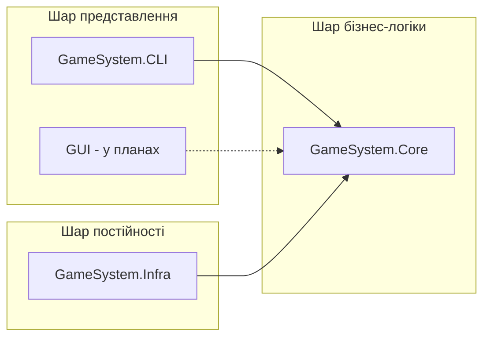
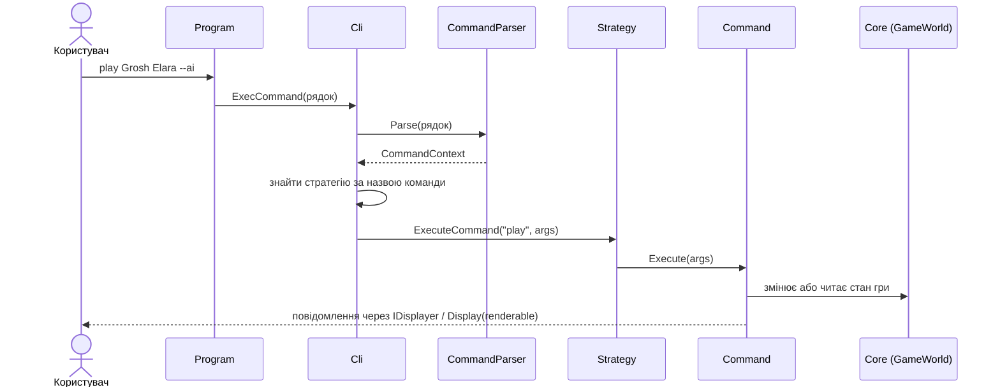
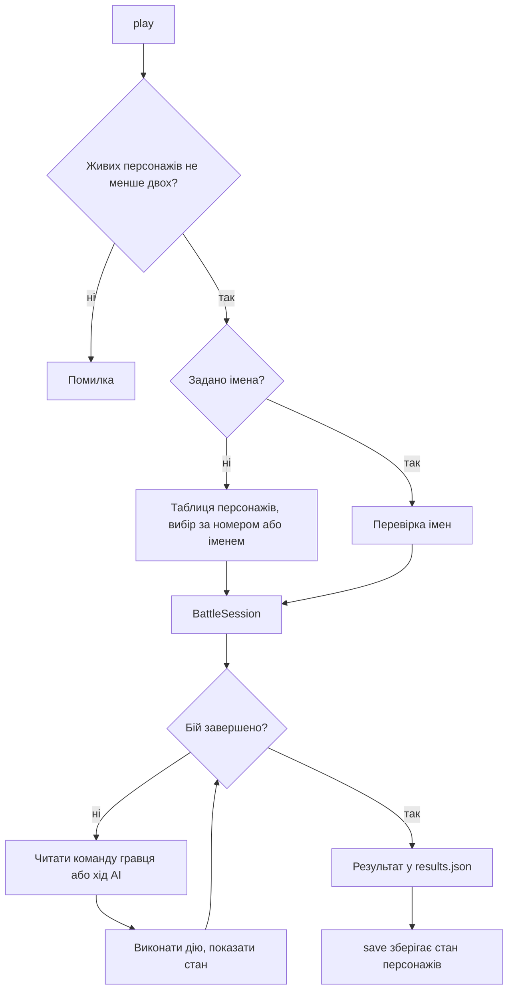
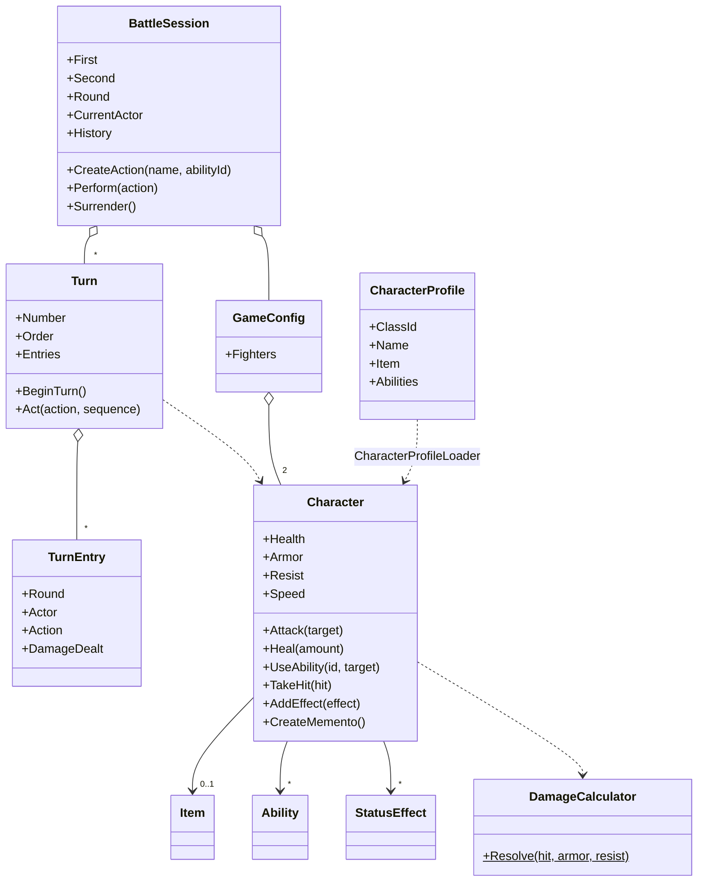
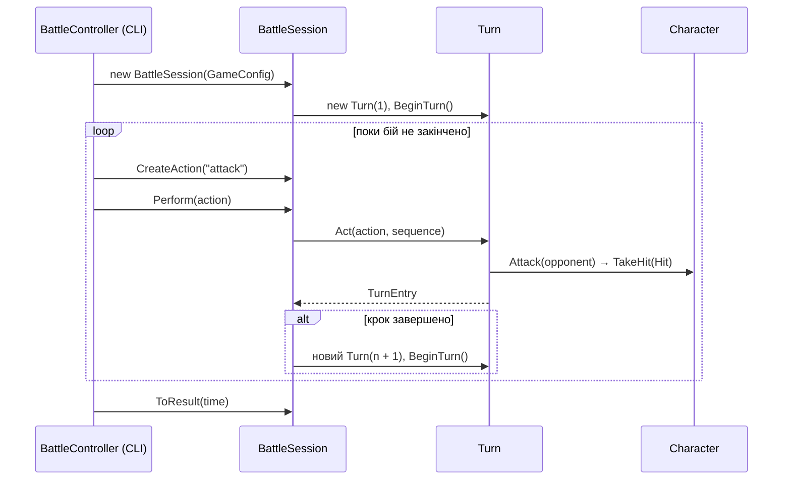

# Дизайн-документ: GameSystem

У цьому документі описано, як влаштований проєкт GameSystem (проста текстова гра). Розділи 1–8 — командний
інтерфейс (практична 13), розділ 9 — бізнес-логіка гри (практична 14).

## 1. Про проєкт

GameSystem — це текстова гра з персонажами. Користувач створює персонажів (Warrior або Mage), предмети і вміння,
одягає предмети, навчає вмінням, бере персонажів із віддаленої бази (Genshin API), б'ється двома персонажами
один проти одного, зберігає стан гри і результати боїв.

Весь функціонал доступний через консольний інтерфейс (CLI). Є ще окремий проєкт `GameSystem.FileManager`
(практична 12, файловий менеджер), який використовує ту саму бібліотеку розбору команд, але до цієї практичної він не належить.

## 2. Загальна архітектура

Проєкт поділений на шари, як на схемі із завдання.



| Проєкт | Що там знаходиться |
|---|---|
| `GameSystem.Core` | правила гри, персонажі, бій, текстова система (документи), інтерфейси (`IDisplayer`, `IRenderer`, репозиторії). Нічого не знає про консоль і файли |
| `GameSystem.Infra` | усе, що працює із зовнішнім світом: консоль, JSON-файли, HTTP-клієнт до Genshin API, текстовий рендер документів |
| `GameSystem.CLI` | консольний інтерфейс: фасад `Cli`, стратегії команд, команди, рендерери, консольна графіка, `Program.cs` |
| `GameSystem.FileManager` | окрема програма (практична 12) |
| `GameSystem.Tests` | xUnit-тести для всіх проєктів |

Головне правило: **залежності йдуть до Core**. Core оголошує інтерфейси (наприклад, `IGameStateRepository`,
`IRenderer<T>`), а Infra і CLI їх реалізують. Тому Core можна тестувати без консолі та диска,
а консоль можна замінити на графічний інтерфейс, не чіпаючи правил гри.

## 3. Командний інтерфейс (детально)

### 3.1. Що він вміє

- вибирати й виконувати команди з аргументами та опціями (`add --char_id Grosh --id Sword`);
- розширюватися новими командами без зміни старого коду;
- виводити об'єкти гри в однаковому, структурованому вигляді (таблиці, смужки здоров'я, документи);
- вести гру: вибір персонажів, початок бою, основний цикл, збереження результатів.

### 3.2. Діаграма класів


### 3.3. Відповідність схемі із завдання

Я взяв **другий варіант схеми** (з `IRenderable`), тому що тоді внутрішні класи самі вирішують, ЯКІ дані показати,
а ЯК це виглядає в консолі вирішує CLI. Залежність іде від CLI до Core, а не навпаки.

| На схемі | У проєкті | Примітка |
|---|---|---|
| `CLI` | `Cli` | фасад із методами `UseStrategy`, `ExecCommand`, `Display` |
| `ArgParser.parseArgs` | `CommandParser.Parse` (`ICommandParser`) | повертає `CommandContext` |
| `Args` | `CommandContext` | назва команди, позиційні аргументи, опції |
| `ICommandStrategy` | `ICommandStrategy` | `GetCommandSelectors`, `RegisterCommand`, `ExecuteCommand` |
| `SpecificStrategy` | `InformationCommandStrategy`, `TransformativeCommandStrategy`, `InfrastructureCommandStrategy`, `BattleCommandStrategy` | три категорії з методичних вказівок + команди бою |
| `registerCommand(Func<?,?>)` | `RegisterCommand(ICommand)` | замість лямбди команда є окремим класом (патерн Command) |
| `IRenderable<T>` | `IRenderable<T>` | у Core; базова реалізація `Renderable<T>` |
| `SpecificRenderable` | `CharacterSheetRenderable`, `RosterRenderable`, `BattleStatusRenderable`, `GameResultsRenderable` | у Core |
| `IRenderer<T>` | `IRenderer<T>` | оголошений у Core, реалізується в CLI |
| `SpecificRenderer` | `TextDocumentRenderer`, `RosterRenderer`, `BattleStatusRenderer`, `GameResultsRenderer` | у CLI |

Чого немає на схемі, але я додав:

- `Cli.UseRenderer<T>` — реєстр рендерерів. `Cli.Display` по типу даних `T` знаходить потрібний рендерер.
  Якщо рендерер не зареєстровано, використовується той, що об'єкт отримав через `UseRenderer`.
- `IDisplayer` (вже був у проєкті) — «порт виводу» нижчого рівня. Рендерери та команди пишуть через нього
  повідомлення (інфо, успіх, попередження, помилка), а реалізація (`ConsoleDisplayer`) вже малює їх у консолі з кольором.

### 3.4. Що відбувається, коли користувач вводить команду



Якщо команда кидає виняток, `Cli` ловить його і показує `Execution Error: ...`, програма не падає.
Якщо команди не існує, показується попередження.

### 3.5. Категорії команд (стратегії)

Методичні вказівки пропонують три категорії. Кожна категорія це окрема стратегія, і `Cli` параметризується ними.

**Information — виводить інформацію, нічого не змінює**

| Команда | Що робить |
|---|---|
| `ls <char\|item\|ability> [--id x]` | список об'єктів (персонажі у вигляді таблиці зі смужкою здоров'я) або деталі одного |
| `sheet <char>` | аркуш персонажа як структурований текстовий документ |
| `results` | історія завершених ігор (таблиця) |
| `help` | усі команди, згруповані за категоріями |

**Transformative — змінює світ гри**

| Команда | Що робить |
|---|---|
| `create <char\|item\|ability>` | створення через діалог |
| `add --char_id x --id y` | одягнути предмет або навчити вмінню |
| `act <attack\|heal\|defend\|ability> <actor> [target] [--id ability]` | одна дія поза боєм |
| `play [char1 char2] [--ai]` | вибір персонажів, початок гри й основний цикл бою |

**Infrastructure — зберігання та зовнішні сервіси**

| Команда | Що робить |
|---|---|
| `save <name>` / `load <name>` / `list` | збереження стану гри, завантаження, список збережень |
| `remote chars\|weapons\|create\|equip` | робота з віддаленою базою персонажів |

Команди, які діють лише під час бою, лежать в окремій стратегії `BattleCommandStrategy`:
`attack`, `heal`, `defend`, `ability [id]`, `status`, `surrender`, `help`.

### 3.6. Гра: вибір персонажів, початок, основний цикл, збереження



- **Вибір персонажів**: `play Grosh Elara` або просто `play` (тоді показується таблиця з номерами).
- **Початок гри**: створюється `BattleSession` (Core). Це покрокова версія бою: гравці ходять по черзі,
  лічильник раунду росте після ходу другого бійця. Автоматичний бій (`Game`) залишився для симуляцій.
- **Основний цикл** (`BattleController`): показати стан, прочитати рядок, виконати його через **окремий `Cli`**
  зі стратегією `BattleCommandStrategy`. Недійсна команда не забирає хід. Опція `--ai` (її краще писати в кінці)
  віддає ходи другого бійця комп'ютеру (`ITurnStrategy`).
- **Збереження результатів**: після перемоги `GameResult` (переможець, переможений, раунди, здоров'я, час UTC)
  додається в `results/game-results.json` через `IGameResultRepository`. Команда `results` показує історію.
- **Збереження стану**: `save <name>` зберігає всіх персонажів із їхнім здоров'ям у `saves/<name>.json`.

### 3.7. Власні моделі CLI

- **Command** — кожна команда окремий клас, який успадковує `CommandBase`: `CreateCommand`, `PlayCommand`, `SaveCommand` тощо.
  Залежності (світ гри, `IDisplayer`, репозиторії) отримує через конструктор.
- **Args** — `CommandContext`.
- **CLI-графіка** (`GameSystem.CLI.Graphics`): `ProgressBar` (смужка здоров'я `[#####-----]`) і `ConsoleTable` (вирівняні таблиці).
- **Prompter** — маленький помічник для діалогів (запитати рядок, запитати невід'ємне число).

## 4. Патерни проєктування

| Патерн | Де |
|---|---|
| Facade | `Cli` — єдина точка входу для зовнішнього коду |
| Strategy | `ICommandStrategy` та його реалізації; `IRenderer<T>`; `ITurnStrategy` для AI |
| Command | `ICommand`, `CommandBase` і конкретні команди; бойові дії `ICombatAction` |
| Visitor | текстова система: `ITextVisitor` і `TextRenderer` |
| Template Method | `CommandBase.Execute` викликає `Run` |
| Memento | збереження персонажів (`CharacterMemento`, `GameStateSnapshotter`) |
| Factory | `CharacterFactory`, `CombatActionFactory` |
| Dependency Injection | `CliFactory` збирає всі частини, тести підставляють підроблені |

## 5. Як розширювати

**Нова команда.** Створити клас, що успадковує `CommandBase`, і зареєструвати його в потрібній стратегії
(`RegisterCommand(new MyCommand(...))`). Більше нічого міняти не треба, команда з'явиться в `help`.

**Нова категорія команд.** Створити клас на основі `CommandStrategyBase` і додати його в `CliFactory` рядком `cli.UseStrategy(...)`.
Якщо дві стратегії мають однакову команду, `UseStrategy` кине виняток.

**Новий спосіб показати дані.** Створити клас, що реалізує `IRenderer<T>`, і зареєструвати його через `cli.UseRenderer(...)`.
Для іншого інтерфейсу (GUI) потрібно лише написати інші рендерери для тих самих `IRenderable<T>`.

## 6. Обробка помилок

- Некоректні аргументи: команда показує `Usage: ...` і нічого не змінює.
- Винятки всередині команд: `Cli` показує `Execution Error`.
- Проблеми файлів і мережі (`IOException`, `HttpRequestException`, пошкоджений JSON): команди показують зрозуміле повідомлення.
- Невдала дія в бою (наприклад, невідоме вміння): хід не передається, гравець пробує ще раз.
- Кінець вводу під час бою: бій вважається покинутим, результат не зберігається.

## 7. Тестування

Тести лежать у `GameSystem.Tests`. Консоль і диск підміняються тест-дублерами (`FakeDisplayer`, `FakeInputReader`,
`InMemoryGameStateRepository`, `InMemoryGameResultRepository`), тому тести швидкі та не залежать від середовища.

- `CLI/CliFacadeTests`, `CLI/CommandStrategyTests` — фасад і стратегії;
- `CLI/CliCommandTests` — усі старі команди через фасад;
- `CLI/PlayCommandTests` — вся гра від вибору персонажів до збереження результату;
- `CLI/GraphicsTests` — смужка здоров'я й таблиці;
- `Core/BattleSessionTests`, `Core/RenderableTests`;
- `Infra/JsonGameResultRepositoryTests`.

## 8. Обмеження й плани

- Бій лише для двох персонажів. Команди бою читаються по черзі з одного вводу (гра за одним комп'ютером).
- GUI ще немає, але шар представлення відділений, тому його можна додати поруч із CLI.
- Опція `--ai` у `play` має стояти після імен, бо парсер вважає наступне слово значенням опції.


## 9. Бізнес-логіка (практичне заняття 14)

Бізнес-логіка живе в `GameSystem.Core`, у шарі посередині схеми. Вона нічого не знає про консоль, файли й мережу:
усе зовнішнє заходить через інтерфейси (`IGameStateRepository`, `ICharacterProfileSource`, `IGenshinApiClient`, `ICombatLogger`),
а їх реалізують `GameSystem.Infra` і `GameSystem.CLI`. Тому гру можна тестувати без консолі й диска, а до ядра можна підключити
інший інтерфейс (GUI).

### 9.1. Характеристики персонажа

| Характеристика | Що означає | Базове значення |
|---|---|---|
| `Health` / `MaxHealth` | скільки життя лишилось / скільки максимум | Warrior 150, Mage 80 |
| `AttackPower` | скільки шкоди завдає удар | Warrior 20, Mage 15 |
| `Armor` | плоский захист: скільки шкоди блокується напряму | Warrior 10, Mage 2 |
| `Resist` | відсоток шкоди, який ігнорується після броні (0–75) | 0, дають предмети й ефекти |
| `Speed` | швидкість: скільки дій і в якому порядку | 100 |

Предмет (`Item`) дає бонуси до всіх п'яти характеристик (`HealthBonus`, `ArmorBonus`, `AttackBonus`, `ResistBonus`, `SpeedBonus`).
Одночасно одягнений один предмет, новий замінює старий. Базові значення я лишив без опору, щоб формули було видно на предметах і навичках.

### 9.2. Формула шкоди

Усю математику я зібрав в одному чистому класі `DamageCalculator` (без стану й без виведення), щоб формулу можна було
перевірити числами й описати тут слово в слово.

```
armor_eff  = ignoresArmor ? 0 : armor
afterArmor = max(1, raw - armor_eff)
resist_eff = clamp(resist - resistPenetration, 0, 75)
damage     = max(1, floor(afterArmor * (100 - resist_eff) / 100))
```

- `raw` — «чиста» шкода удару: `AttackPower` для звичайної атаки, або значення навички.
- Спочатку віднімається броня, потім застосовується відсоток опору (відносно 100 %).
- Магічна шкода (`ignoresArmor = true`) броню пропускає, але опір на неї діє; `resistPenetration` зменшує опір цілі на стільки відсоткових пунктів.
- Мінімальна шкода дорівнює 1. Відмінність від найпростішого прикладу з методички, де броня може перекрити удар повністю:
  я залишив мінімум 1, щоб бій двох ледь пробиваних бійців не міг тривати вічно (цей мінімум уже був у моїй грі).
- Округлення вниз (цілочисельне ділення), опір має стелю 75 %, тому імунітету не буває.

Приклади (їх перевіряють тести `DamageCalculatorTests`):

| raw | armor | resist | результат | пояснення |
|---|---|---|---|---|
| 30 | 10 | 0 | 20 | тільки броня |
| 30 | 10 | 50 | 10 | (30 − 10) · 50 % |
| 5 | 10 | 0 | 1 | броня більша за удар, лишається подряпина |
| 100 | 0 | 90 | 25 | опір обрізається до 75 % |
| 40 (магія) | 5 | 50, penetration 20 | 28 | броня ігнорується, опір 30 %, 40 · 70 % |

**Ефективні характеристики.** У формулу йдуть не базові значення, а ефективні:

```
effective_stat = base_stat + item_bonus + Σ (buff_i + debuff_i)
EffectiveArmor = max(0, armor + Σ effects) · (defending ? 2 : 1)
```

`AttackPower`, `Armor`, `Resist`, `Speed` вже містять бонус предмета (він додається, коли предмет одягають),
а бонуси й штрафи ефектів додаються поверх цього при кожному обчисленні.

### 9.3. Дії персонажа

| Дія | Що відбувається |
|---|---|
| `attack` | `raw = EffectiveAttack`, фізичний удар |
| `ability [id]` | удар за стратегією навички (`IDamageStrategy`): фіксований або залежний від атаки; може ігнорувати броню, пробивати опір і накладати ефект |
| `defend` | `EffectiveArmor` подвоюється до наступного отриманого удару |
| `heal` | відновлює 20 здоров'я, не більше за `MaxHealth` |

Вбудовані навички класів:

| Навичка | Удар | Ефект |
|---|---|---|
| Heavy Strike (Warrior) | `EffectiveAttack · 2`, фізичний | Armor Break: броня цілі −3 на 2 ходи |
| Fireball (Mage) | 35, ігнорує броню, пробиває 20 % опору | Scorched: опір цілі −10 на 2 ходи |

### 9.4. Баффи та дебафи (`StatusEffect`)

Тимчасовий модифікатор однієї характеристики: `Name`, `Stat` (Attack, Armor, Resist, Speed), `Amount` (додатне — бафф, від'ємне — дебафф) і `Turns`.

- Ефект з тією самою назвою оновлюється, а не накопичується.
- На початку кожного ходу (`Turn.BeginTurn`) кожному ефекту лишається на 1 хід менше, ті, що дійшли до нуля, знімаються.
- Якщо ціль загинула від удару, ефект на неї не накладається.
- Ефекти живуть лише в межах одного бою: `BattleSession` знімає їх з обох бійців на старті.

### 9.5. Швидкість і порядок дій

Крок гри (`Turn`) — один раунд. Усі діють у порядку швидкості, а швидкий боєць може діяти двічі й більше:

```
actions_i = max(1, floor(speed_i / slowestSpeed))
k-та з n дій бійця відбувається в момент k / n кроку
в один момент першим іде швидший, при рівній швидкості — той, кого вказали першим
```

| Швидкості | Порядок у кроці |
|---|---|
| 100 і 100 | A, B |
| 150 (B) і 100 (A) | B, A |
| 200 (A) і 100 (B) | A, B, A (додаткова дія посередині кроку) |

Порядок фіксується після того, як ефекти на початку кроку зменшили свій термін, тому бафф швидкості впливає на крок, в якому він ще діє.

### 9.6. Структура класів



Відповідність діаграмі із завдання:

| На діаграмі | У проєкті | Примітка |
|---|---|---|
| `Game` (`setupGame`, `startGame(GameConfig)`) | `BattleSession` | налаштування — це створення `GameConfig`, старт — конструктор `BattleSession(GameConfig)`. Старий `Game` (автоматична симуляція) я залишив для `ConsoleApp` |
| `GameConfig` | `GameConfig` | зараз тільки список із двох бійців |
| `Turn` (`beginTurn`, `act`) | `Turn` (`BeginTurn`, `Act`) | `Act` приймає команду `ICombatAction`, а не `ActionId` + двох персонажів: ціль уже вкладена в команду |
| `Character` (`attack`, `heal`, `action`, `checkStatus`) | `Character` (`Attack`, `Heal`, `UseAbility`, `Health`/`IsDefending`) | `action(int, Character)` → `UseAbility(id, target)`, `checkStatus` → властивості стану й `BattleStatusRenderable` |
| `CharacterProfile` (`addItem`, `addAbility`) | `CharacterProfile` + `CharacterProfileLoader` | профіль — чисті дані, `Equip` і `Learn` робить завантажувач |
| `Item`, `Ability` | `Item`, `Ability` | |

Патерни, які тут працюють: **Command** (`ICombatAction`), **Strategy** (`IDamageStrategy`, `ITurnStrategy`), **Memento** (стан персонажа й гри),
**Factory** (`CharacterFactory`, `CombatActionFactory`), а `DamageCalculator` — чиста функція, яку легко тестувати.

### 9.7. Основний цикл



Якщо дія кидає виняток (наприклад, невідома навичка), нічого не змінюється: хід не передається і в історію нічого не потрапляє.
Лічильник раунду зростає, коли завершується крок, тобто коли діяв останній боєць із порядку.

### 9.8. Історія кроків

Кожна виконана дія стає записом `TurnEntry`: номер дії, раунд, хто діяв, проти кого, яка дія та здоров'я обох до і після.
З нього обчислюються `DamageDealt` і `HealthRestored`. У бою історію показує команда `history`, після завершення бою вона виводиться автоматично таблицею:

```
| # | Round | Actor | Action  | Result                       |
| 1 | 1     | Grosh | attack  | Elara -18 HP (80 -> 62)      |
| 2 | 1     | Elara | defend  | no change in health          |
```

### 9.9. Збереження стану й завантаження нових персонажів

**Збереження.** `save <n>` працює і в головному інтерфейсі, і прямо під час бою (це та сама команда `SaveCommand`).
Стан світу (предмети, навички, персонажі з поточним здоров'ям, одягненим предметом і вивченими навичками) збирається через `Memento` і
`GameStateSnapshotter`, а в JSON його записує Infra (`JsonGameStateRepository`). Нові характеристики предметів (`resistBonus`, `speedBonus`)
теж зберігаються; у старих файлах їх немає, тоді вони дорівнюють 0. Результати завершених боїв додаються в `results/game-results.json`.

**Завантаження персонажів.** Три способи:

1. `create char` — діалог.
2. `remote create` — персонаж із Genshin API (`IGenshinApiClient`); його стартовий предмет тепер дає й опір та швидкість залежно від рідкості.
3. `import <name>` — профіль із файлу `characters/<name>.json` (`ICharacterProfileSource`, у Infra це `JsonCharacterProfileSource`).

Формат профілю (приклад у `samples/characters/zed.json`, його треба покласти в папку `characters` поруч із запуском):

```json
{
  "classId": "mage",
  "name": "Zed",
  "item": { "name": "Storm Cape", "resistBonus": 20, "speedBonus": 25 },
  "abilities": [
    { "id": "lightning-bolt", "description": "Lightning Bolt", "power": 30, "ignoresArmor": true }
  ]
}
```

`CharacterProfileLoader` будує персонажа, одягає предмет і вчить навички, а команда `import` додає результат у світ, тільки якщо весь профіль коректний
(невідомий клас, дубль імені чи битий файл дають повідомлення про помилку й нічого не змінюють).

### 9.10. Межі шару та заглушки

Core оголошує тільки інтерфейси: `IGameStateRepository`, `IGameResultRepository`, `ICharacterProfileSource`, `IGenshinApiClient`, `ICombatLogger`.
У тестах їх замінюють `InMemoryGameStateRepository`, `InMemoryGameResultRepository` і заглушка профілів, а в програмі — реалізації з Infra.
Core не посилається ні на CLI, ні на Infra.

### 9.11. Тестування бізнес-логіки

- `Core/BusinessLogicTests` — формула шкоди, опір, баффи й дебафи, їх закінчення, швидкість і порядок дій, `GameConfig`, історія, завантажувач профілів;
- `Infra/JsonCharacterProfileSourceTests` — читання профілів, помилки, збереження нових полів предметів;
- `CLI/BusinessLogicCliTests` — `import`, `history`, `save` під час бою, історія в кінці бою.

### 9.12. Обмеження

- Бій лише для двох персонажів (`GameConfig` вимагає рівно двох).
- `save` під час бою зберігає персонажів і їх здоров'я, а не позицію в кроці, баффи й історію бою; продовжити бій із середини після `load` не можна, зате можна почати новий.
- Ефекти навичок є тільки в вбудованих навичок класів; навички з файлів і сейвів ефектів не мають.
