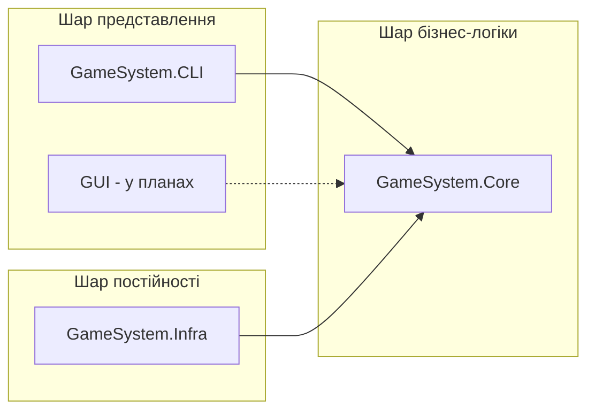
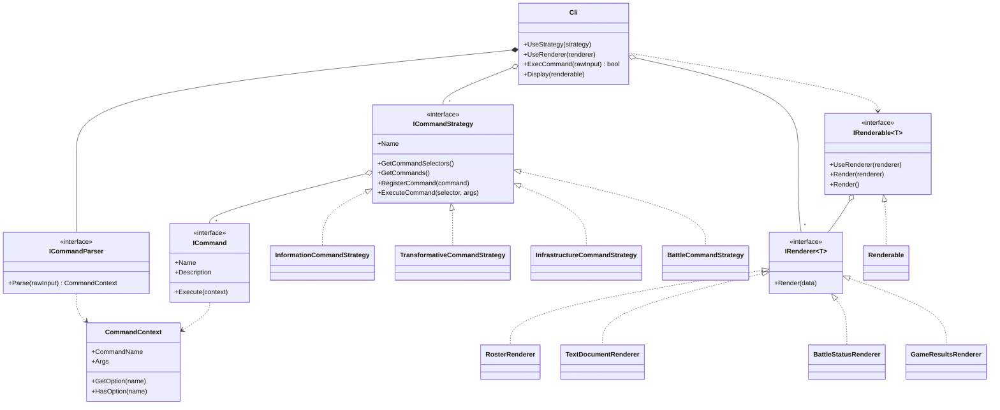
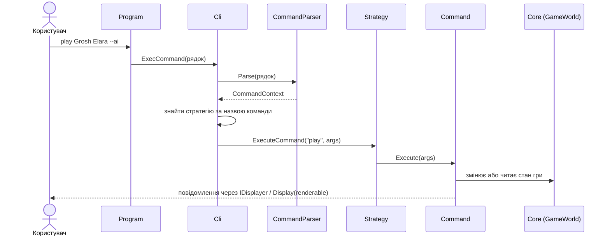
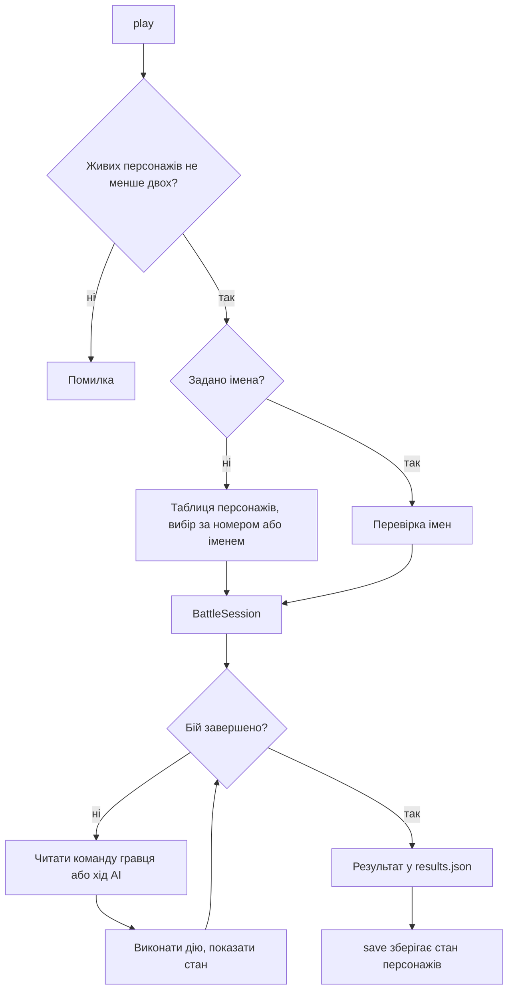

# Дизайн-документ: GameSystem — командний інтерфейс (CLI)

Практичне заняття 13. У цьому документі описано, як влаштований проєкт GameSystem (проста текстова гра)
і, більш детально, його консольна частина.

## 1. Про проєкт

GameSystem — це текстова гра з персонажами. Користувач створює персонажів (Warrior або Mage), предмети і вміння,
одягає предмети, навчає вмінням, бере персонажів із віддаленої бази (Genshin API), б'ється двома персонажами
один проти одного, зберігає стан гри і результати боїв.

Весь функціонал доступний через консольний інтерфейс (CLI). Є ще окремий проєкт `GameSystem.FileManager`
(практична 12, файловий менеджер), який використовує ту саму бібліотеку розбору команд, але до цієї практичної він не належить.

## 2. Загальна архітектура

Проєкт поділений на шари, як на схемі із завдання.

| Проєкт | Що там знаходиться |
|---|---|
| `GameSystem.Core` | правила гри, персонажі, бій, текстова система (документи), інтерфейси (`IDisplayer`, `IRenderer`, репозиторії). Нічого не знає про консоль і файли |
| `GameSystem.Infra` | усе, що працює із зовнішнім світом: консоль, JSON-файли, HTTP-клієнт до Genshin API, текстовий рендер документів |
| `GameSystem.CLI` | консольний інтерфейс: фасад `Cli`, стратегії команд, команди, рендерери, консольна графіка, `Program.cs` |
| `GameSystem.FileManager` | окрема програма (практична 12) |
| `GameSystem.Tests` | xUnit-тести для всіх проєктів |

Головне правило: **залежності йдуть до Core**. Core оголошує інтерфейси (наприклад, `IGameStateRepository`,
`IRenderer<T>`), а Infra і CLI їх реалізують. Тому Core можна тестувати без консолі та диска,
а консоль можна замінити на графічний інтерфейс, не чіпаючи правил гри.

## 3. Командний інтерфейс (детально)

### 3.1. Що він вміє

- вибирати й виконувати команди з аргументами та опціями (`add --char_id Grosh --id Sword`);
- розширюватися новими командами без зміни старого коду;
- виводити об'єкти гри в однаковому, структурованому вигляді (таблиці, смужки здоров'я, документи);
- вести гру: вибір персонажів, початок бою, основний цикл, збереження результатів.

### 3.2. Діаграма класів

### 3.3. Відповідність схемі із завдання

Я взяв **другий варіант схеми** (з `IRenderable`), тому що тоді внутрішні класи самі вирішують, ЯКІ дані показати,
а ЯК це виглядає в консолі вирішує CLI. Залежність іде від CLI до Core, а не навпаки.

| На схемі | У проєкті | Примітка |
|---|---|---|
| `CLI` | `Cli` | фасад із методами `UseStrategy`, `ExecCommand`, `Display` |
| `ArgParser.parseArgs` | `CommandParser.Parse` (`ICommandParser`) | повертає `CommandContext` |
| `Args` | `CommandContext` | назва команди, позиційні аргументи, опції |
| `ICommandStrategy` | `ICommandStrategy` | `GetCommandSelectors`, `RegisterCommand`, `ExecuteCommand` |
| `SpecificStrategy` | `InformationCommandStrategy`, `TransformativeCommandStrategy`, `InfrastructureCommandStrategy`, `BattleCommandStrategy` | три категорії з методичних вказівок + команди бою |
| `registerCommand(Func<?,?>)` | `RegisterCommand(ICommand)` | замість лямбди команда є окремим класом (патерн Command) |
| `IRenderable<T>` | `IRenderable<T>` | у Core; базова реалізація `Renderable<T>` |
| `SpecificRenderable` | `CharacterSheetRenderable`, `RosterRenderable`, `BattleStatusRenderable`, `GameResultsRenderable` | у Core |
| `IRenderer<T>` | `IRenderer<T>` | оголошений у Core, реалізується в CLI |
| `SpecificRenderer` | `TextDocumentRenderer`, `RosterRenderer`, `BattleStatusRenderer`, `GameResultsRenderer` | у CLI |

Чого немає на схемі, але я додав:

- `Cli.UseRenderer<T>` — реєстр рендерерів. `Cli.Display` по типу даних `T` знаходить потрібний рендерер.
  Якщо рендерер не зареєстровано, використовується той, що об'єкт отримав через `UseRenderer`.
- `IDisplayer` (вже був у проєкті) — «порт виводу» нижчого рівня. Рендерери та команди пишуть через нього
  повідомлення (інфо, успіх, попередження, помилка), а реалізація (`ConsoleDisplayer`) вже малює їх у консолі з кольором.

### 3.4. Що відбувається, коли користувач вводить команду

Якщо команда кидає виняток, `Cli` ловить його і показує `Execution Error: ...`, програма не падає.
Якщо команди не існує, показується попередження.

### 3.5. Категорії команд (стратегії)

Методичні вказівки пропонують три категорії. Кожна категорія це окрема стратегія, і `Cli` параметризується ними.

**Information — виводить інформацію, нічого не змінює**

| Команда | Що робить |
|---|---|
| `ls <char\|item\|ability> [--id x]` | список об'єктів (персонажі у вигляді таблиці зі смужкою здоров'я) або деталі одного |
| `sheet <char>` | аркуш персонажа як структурований текстовий документ |
| `results` | історія завершених ігор (таблиця) |
| `help` | усі команди, згруповані за категоріями |

**Transformative — змінює світ гри**

| Команда | Що робить |
|---|---|
| `create <char\|item\|ability>` | створення через діалог |
| `add --char_id x --id y` | одягнути предмет або навчити вмінню |
| `act <attack\|heal\|defend\|ability> <actor> [target] [--id ability]` | одна дія поза боєм |
| `play [char1 char2] [--ai]` | вибір персонажів, початок гри й основний цикл бою |

**Infrastructure — зберігання та зовнішні сервіси**

| Команда | Що робить |
|---|---|
| `save <name>` / `load <name>` / `list` | збереження стану гри, завантаження, список збережень |
| `remote chars\|weapons\|create\|equip` | робота з віддаленою базою персонажів |

Команди, які діють лише під час бою, лежать в окремій стратегії `BattleCommandStrategy`:
`attack`, `heal`, `defend`, `ability [id]`, `status`, `surrender`, `help`.

### 3.6. Гра: вибір персонажів, початок, основний цикл, збереження

- **Вибір персонажів**: `play Grosh Elara` або просто `play` (тоді показується таблиця з номерами).
- **Початок гри**: створюється `BattleSession` (Core). Це покрокова версія бою: гравці ходять по черзі,
  лічильник раунду росте після ходу другого бійця. Автоматичний бій (`Game`) залишився для симуляцій.
- **Основний цикл** (`BattleController`): показати стан, прочитати рядок, виконати його через **окремий `Cli`**
  зі стратегією `BattleCommandStrategy`. Недійсна команда не забирає хід. Опція `--ai` (її краще писати в кінці)
  віддає ходи другого бійця комп'ютеру (`ITurnStrategy`).
- **Збереження результатів**: після перемоги `GameResult` (переможець, переможений, раунди, здоров'я, час UTC)
  додається в `results/game-results.json` через `IGameResultRepository`. Команда `results` показує історію.
- **Збереження стану**: `save <name>` зберігає всіх персонажів із їхнім здоров'ям у `saves/<name>.json`.

### 3.7. Власні моделі CLI

- **Command** — кожна команда окремий клас, який успадковує `CommandBase`: `CreateCommand`, `PlayCommand`, `SaveCommand` тощо.
  Залежності (світ гри, `IDisplayer`, репозиторії) отримує через конструктор.
- **Args** — `CommandContext`.
- **CLI-графіка** (`GameSystem.CLI.Graphics`): `ProgressBar` (смужка здоров'я `[#####-----]`) і `ConsoleTable` (вирівняні таблиці).
- **Prompter** — маленький помічник для діалогів (запитати рядок, запитати невід'ємне число).

## 4. Патерни проєктування

| Патерн | Де |
|---|---|
| Facade | `Cli` — єдина точка входу для зовнішнього коду |
| Strategy | `ICommandStrategy` та його реалізації; `IRenderer<T>`; `ITurnStrategy` для AI |
| Command | `ICommand`, `CommandBase` і конкретні команди; бойові дії `ICombatAction` |
| Visitor | текстова система: `ITextVisitor` і `TextRenderer` |
| Template Method | `CommandBase.Execute` викликає `Run` |
| Memento | збереження персонажів (`CharacterMemento`, `GameStateSnapshotter`) |
| Factory | `CharacterFactory`, `CombatActionFactory` |
| Dependency Injection | `CliFactory` збирає всі частини, тести підставляють підроблені |

## 5. Як розширювати

**Нова команда.** Створити клас, що успадковує `CommandBase`, і зареєструвати його в потрібній стратегії
(`RegisterCommand(new MyCommand(...))`). Більше нічого міняти не треба, команда з'явиться в `help`.

**Нова категорія команд.** Створити клас на основі `CommandStrategyBase` і додати його в `CliFactory` рядком `cli.UseStrategy(...)`.
Якщо дві стратегії мають однакову команду, `UseStrategy` кине виняток.

**Новий спосіб показати дані.** Створити клас, що реалізує `IRenderer<T>`, і зареєструвати його через `cli.UseRenderer(...)`.
Для іншого інтерфейсу (GUI) потрібно лише написати інші рендерери для тих самих `IRenderable<T>`.

## 6. Обробка помилок

- Некоректні аргументи: команда показує `Usage: ...` і нічого не змінює.
- Винятки всередині команд: `Cli` показує `Execution Error`.
- Проблеми файлів і мережі (`IOException`, `HttpRequestException`, пошкоджений JSON): команди показують зрозуміле повідомлення.
- Невдала дія в бою (наприклад, невідоме вміння): хід не передається, гравець пробує ще раз.
- Кінець вводу під час бою: бій вважається покинутим, результат не зберігається.

## 7. Тестування

Тести лежать у `GameSystem.Tests`. Консоль і диск підміняються тест-дублерами (`FakeDisplayer`, `FakeInputReader`,
`InMemoryGameStateRepository`, `InMemoryGameResultRepository`), тому тести швидкі та не залежать від середовища.

- `CLI/CliFacadeTests`, `CLI/CommandStrategyTests` — фасад і стратегії;
- `CLI/CliCommandTests` — усі старі команди через фасад;
- `CLI/PlayCommandTests` — вся гра від вибору персонажів до збереження результату;
- `CLI/GraphicsTests` — смужка здоров'я й таблиці;
- `Core/BattleSessionTests`, `Core/RenderableTests`;
- `Infra/JsonGameResultRepositoryTests`.

## 8. Обмеження й плани

- Бій лише для двох персонажів. Команди бою читаються по черзі з одного вводу (гра за одним комп'ютером).
- GUI ще немає, але шар представлення відділений, тому його можна додати поруч із CLI.
- Опція `--ai` у `play` має стояти після імен, бо парсер вважає наступне слово значенням опції.
